<div align="center">

# FitShake 健身饮品点单小程序

面向健身人群的**饮品 / 补剂到店自取点单**微信小程序

原生小程序 · Node.js + Express · MySQL

</div>

---

## 项目简介

FitShake 是一款面向健身人群的到店自取点单小程序。用户可以注册登录、浏览分类商品、查看商品详情并选择温度与份量、收藏喜欢的饮品、管理收货地址，加入购物车后下单，到店凭取餐码取餐；下单后按实付金额累计「肌币」并对应会员等级。项目同时提供门店定位导航与补剂科普内容。

技术上采用 **原生微信小程序 + Node.js/Express + MySQL** 的前后端分离架构。后端实现了 JWT 鉴权、服务端权威计价、幂等下单、积分流水与越权防护。

## 功能截图

> 以下截图为真机运行效果。

<table>
  <tr>
    <td align="center">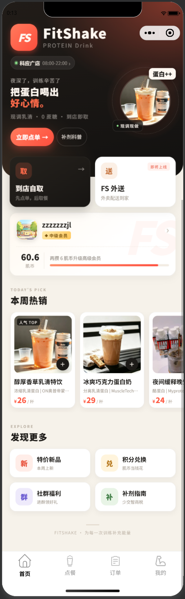<br/><sub>首页 · 会员与今日推荐</sub></td>
    <td align="center">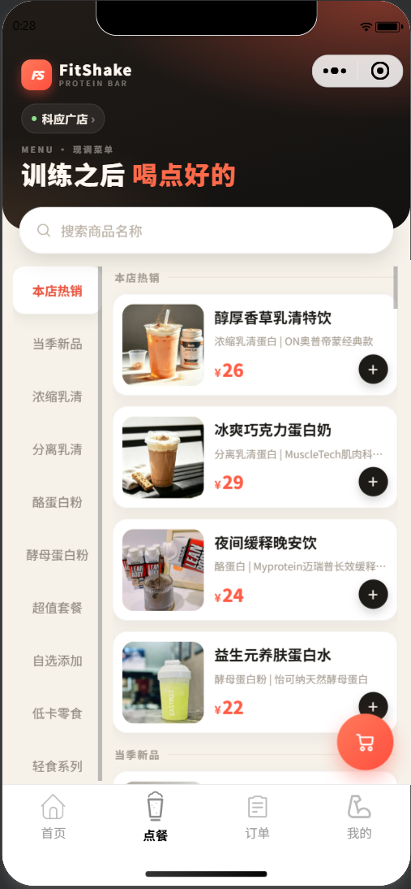<br/><sub>点餐 · 分类与商品</sub></td>
    <td align="center">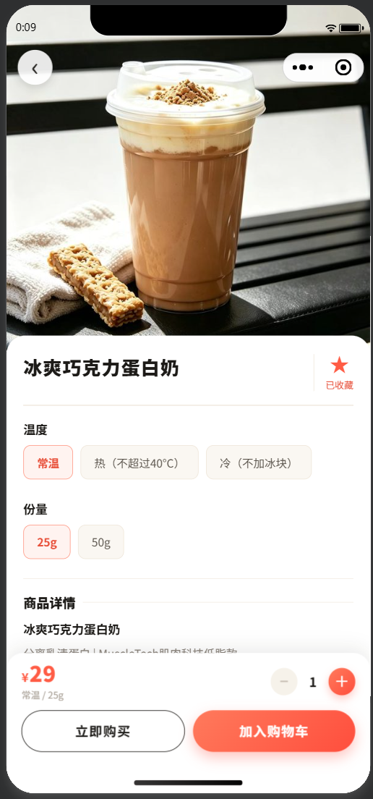<br/><sub>商品详情 · 温度份量与收藏</sub></td>
  </tr>
  <tr>
    <td align="center">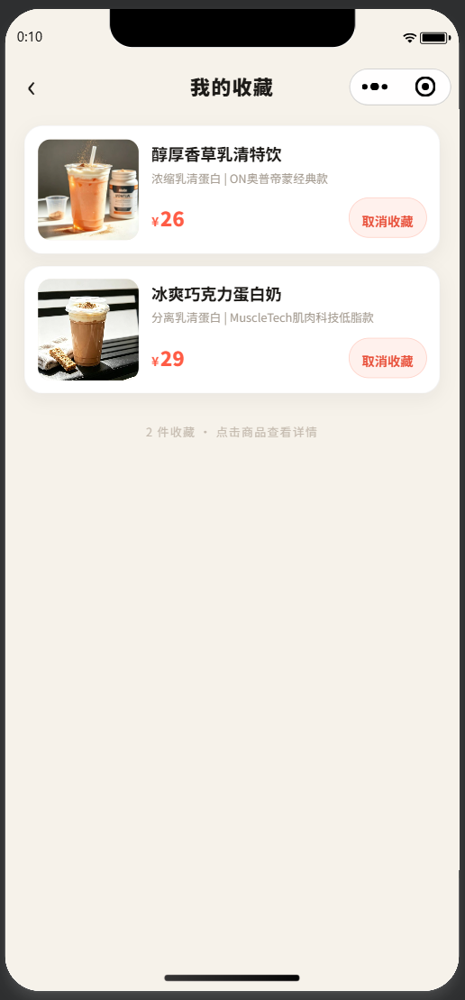<br/><sub>收藏 · 收藏的饮品</sub></td>
    <td align="center">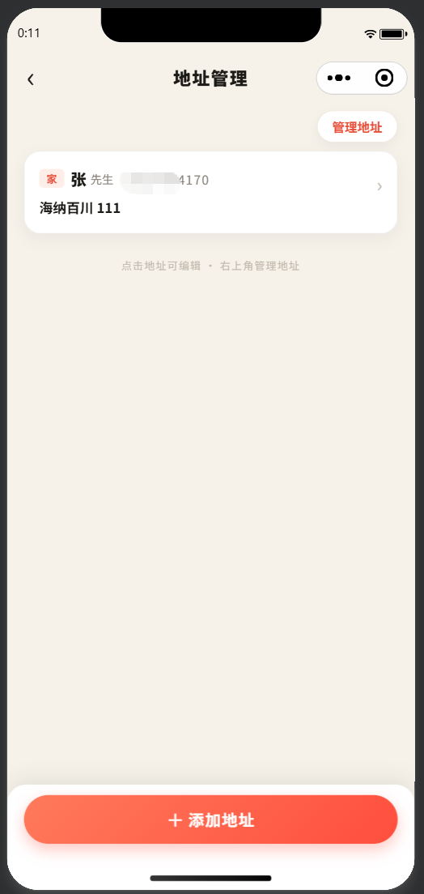<br/><sub>地址管理 · 收货地址</sub></td>
    <td align="center">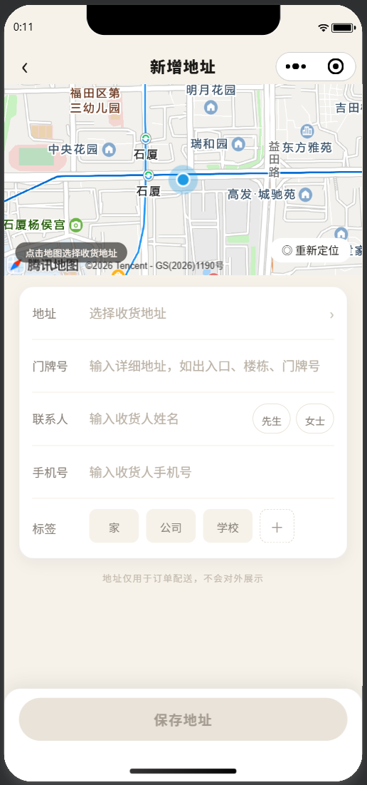<br/><sub>新增地址 · 地图选点</sub></td>
  </tr>
  <tr>
    <td align="center">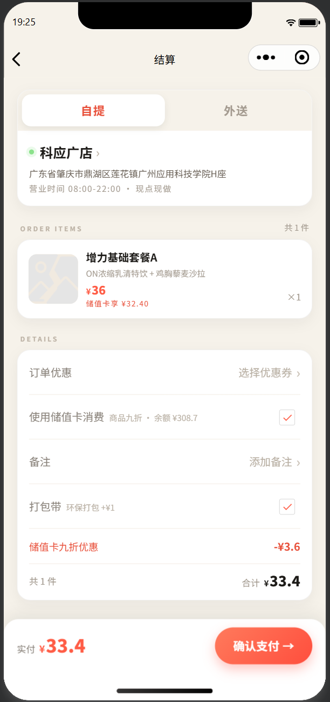<br/><sub>结算 · 备注与打包袋</sub></td>
    <td align="center">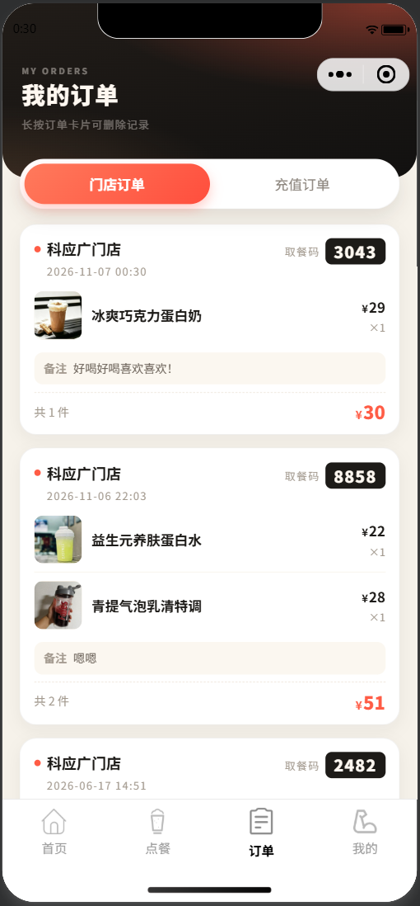<br/><sub>订单 · 取餐码与备注</sub></td>
    <td align="center">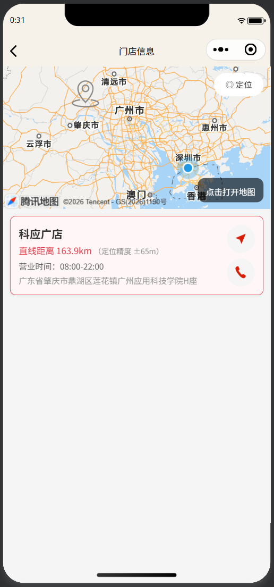<br/><sub>门店 · 定位与导航</sub></td>
  </tr>
  <tr>
    <td align="center">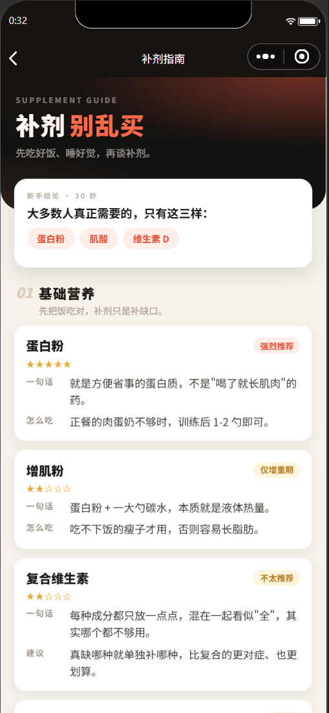<br/><sub>补剂科普 · 分类与用法</sub></td>
    <td align="center">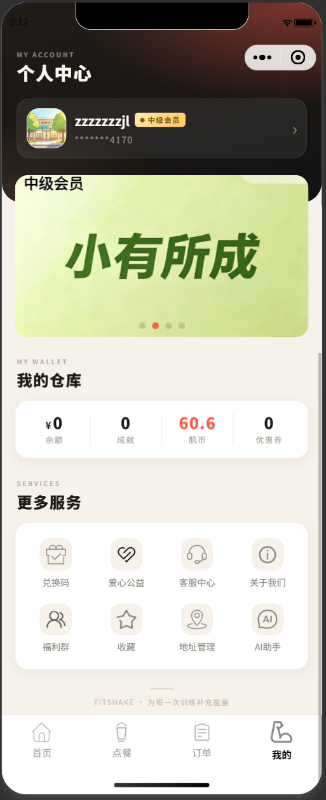<br/><sub>个人中心 · 会员与更多服务</sub></td>
    <td></td>
  </tr>
</table>

## 核心功能

| 模块 | 功能 |
|---|---|
| 账号体系 | 手机号注册 / 登录，支持验证码与密码两种方式，中国大陆手机号格式校验，JWT 登录态，个人页手机号脱敏展示 |
| 商品浏览 | 分类切换、关键词搜索、商品图文展示 |
| 商品详情 | 温度（常温 / 热 / 冷）与份量（25g / 50g）选择、商品描述、数量调节、收藏、立即购买 / 加入购物车 |
| 收藏 | 收藏 / 取消收藏，收藏列表，与商品详情页收藏状态联动 |
| 购物车 | 加购、数量增减、删除、清空，数据存储在服务端并支持多端同步 |
| 收货地址 | 地图选点自动填充、门牌号、联系人称谓、手机号、标签，最多 20 条，支持多选删除与点击编辑 |
| 下单结算 | 服务端计价、打包费、订单备注、幂等提交、取餐码自动生成 |
| 订单管理 | 门店订单列表、商品快照、备注展示、长按删除 |
| 会员积分 | 下单自动发放肌币、积分流水记录、会员等级划分 |
| 个人资料 | 头像上传、昵称 / 性别 / 生日编辑 |
| 门店服务 | 实时定位、与门店直线距离计算、一键导航、拨打电话 |
| 内容科普 | 补剂分类、成分、作用、用法与推荐度 |

## 技术栈

| 层次 | 技术 |
|---|---|
| 小程序端 | 原生微信小程序（WXML / WXSS / JS），`glass-easel` 组件框架，自定义 tab-bar 组件，自定义导航栏 |
| 后端 | Node.js + Express 4、`mysql2/promise` 连接池、JWT、bcryptjs、multer |
| 数据库 | MySQL（用户、商品、购物车、订单、地址、收藏、积分流水等表） |
| 通信 | `wx.request` / `wx.uploadFile`，统一响应结构 `{ code, data, msg }` |
| 状态管理 | 本地存储 + `globalData`，接口失败时降级为只读缓存 |

## 技术亮点

1. **服务端权威计价**
   前端下单只提交 `goods_id` 和 `quantity`，商品名称、单价、打包费与实付金额全部由后端从数据库读取并在事务内计算，从根源上杜绝篡改金额。

2. **幂等下单**
   结算页生成唯一 `request_id`，重复提交复用同一订单；数据库唯一索引兜底，避免网络抖动导致重复下单。

3. **取餐码防冲突**
   后端随机生成取餐码，写入前检查唯一性，冲突自动重试，最终由唯一索引保证。

4. **JWT 鉴权与越权防护**
   `requireAuth` / `ensureSelf` / `ensureCartOwner` / `ensureAddressOwner` 等中间件逐层校验，用户只能访问和操作自己的购物车、订单、地址、收藏与资料；伪造 `user_id` 会被忽略。

5. **积分只能由后端发放**
   资料更新接口不接受 `jb` 字段；下单事务内按实付金额发放积分，并写入 `jb_logs` 流水（变更来源、变更值、余额快照），便于对账与追溯。

6. **金额以「分」为单位运算**
   全链路使用整数分计算，最后统一格式化为两位小数，避免浮点误差。

7. **多环境与真机调试**
   按 `develop / trial / release` 自动切换接口地址，支持真机调试时用局域网地址覆盖，头像等静态资源以相对路径存储，换 IP / 域名不失效。

8. **离线只读降级**
   后端不可用时展示本地缓存订单并明确提示，不在本地伪造或修改数据，避免脏数据回写。

9. **收藏去重**
   `favorites` 表对 `(user_id, goods_id)` 建立唯一索引，重复点击收藏不会产生重复记录；收藏列表一次 JOIN 商品表返回完整信息。

## 系统架构

```text
┌──────────────────────┐        JSON / JWT        ┌───────────────────────┐
│   微信小程序（原生）    │ ───────────────────────> │   Node.js + Express   │
│  WXML / WXSS / JS    │ <─────────────────────── │  鉴权 / 参数校验 / 事务  │
└──────────────────────┘                          └───────────┬───────────┘
                                                              │ mysql2
                                                  ┌───────────▼───────────┐
                                                  │         MySQL         │
                                                  │ users / goods / cart  │
                                                  │ orders / addresses    │
                                                  │ favorites / jb_logs   │
                                                  └───────────────────────┘
```

## 项目结构

```text
FitShake/
├─ pages/                 业务页面
│  ├─ home/               首页
│  ├─ menu/               点餐与购物车
│  ├─ goods/detail/       商品详情（温度 / 份量、收藏、加购）
│  ├─ favorite/           我的收藏
│  ├─ address/            收货地址列表
│  │  └─ edit/            新增 / 编辑地址（地图选点）
│  ├─ checkout/           结算与下单
│  ├─ order/              订单列表
│  ├─ mine/               个人中心与资料编辑
│  ├─ store/              门店定位与导航
│  └─ supplement/         补剂科普
├─ components/tab-bar/    自定义底部导航
├─ utils/                 请求封装、环境配置、距离计算、门店配置、导航栏尺寸
├─ images/                本地图片资源
└─ server/                后端服务
   ├─ routes/             鉴权 / 用户 / 商品 / 购物车 / 订单 / 地址 / 收藏
   ├─ middleware/         JWT 鉴权与越权校验
   ├─ helpers/            计价、取餐码、用户序列化
   └─ sql/                建表脚本、种子数据与迁移脚本
```

## 视觉设计

<div align="center">
  
  
  
  
</div>

## 项目说明

- **支付**：当前为确认弹窗模拟，尚未接入微信支付。
- **源码**：源码仓库为私有，如需查看代码或现场演示，欢迎联系我。
- 项目持续迭代中，欢迎交流建议。

---

<div align="center">

FitShake · 为每一次训练补充能量

</div>
